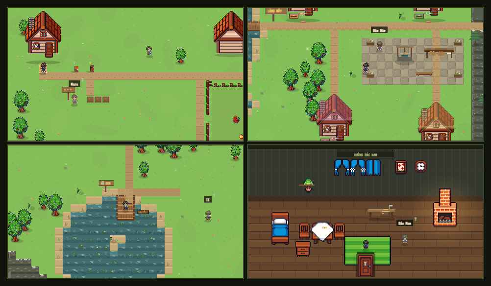

# SOILITARY — A Lone Soldier's Harvest

Một tựa game nông trại pixel 16×16, nơi một người lính trở về và hồi sinh khu vườn của bà trong 12 ngày. Qua cây cầu phía đông là **Làng Mây** — một thung lũng nhỏ bên sông, có những người hàng xóm, một lớp học, một xưởng mộc, và một hồ nước lặng dưới chân núi.



*Bốn khung cảnh trong game: trang trại của bà, Làng Mây, Hồ Sen và xưởng của bác Nam.*

## Chơi game

Không cần cài đặt hay build. Chỉ cần mở `index.html` bằng trình duyệt hiện đại.

Nên chạy qua một HTTP server nhỏ để mọi tài nguyên hoạt động ổn định:

```bash
cd soilitary
python -m http.server 4173
```

Sau đó mở: <http://127.0.0.1:4173>

> Chơi trên máy tính hoặc điện thoại ở chế độ xoay ngang. Nếu dùng điện thoại, hãy xoay ngang màn hình khi thấy lời nhắc.

## Điều khiển

| Phím / thao tác | Chức năng |
| --- | --- |
| `WASD` / phím mũi tên | Di chuyển |
| `E` / `Space` | Tương tác theo ngữ cảnh (cuốc, gieo, tưới, thu hoạch, cho ăn, mở hòm, vào nhà, nói chuyện…) |
| `1` – `4` | Chọn hạt giống |
| `J` | Mở nhật ký: nhiệm vụ, dân làng, thư, hướng dẫn |
| `R` | Ăn khẩu phần, hồi 25 năng lượng |
| `Esc` | Tạm dừng / đóng cửa sổ |
| Nút tròn góc phải | Nhật ký, khẩu phần, tạm dừng (dùng được bằng chuột hoặc cảm ứng) |
| Joystick / nút `E` trên màn hình | Điều khiển cảm ứng trên thiết bị di động |

## Cách chơi

- **Cuốc đất** ở ô cỏ trống, **gieo hạt**, rồi **tưới nước**.
- Cây chỉ lớn sau khi bạn ngủ. Hãy tưới lại mỗi ngày để cây không ngừng phát triển.
- Thu hoạch nông sản và bán ở **hòm gửi hàng** cạnh nhà để lấy xu.
- Mua hạt giống, thức ăn, khẩu phần và vật nuôi ở **hòm tiếp tế**.
- Cho vật nuôi ăn để nhận trứng hoặc sữa vào ngày hôm sau; vuốt ve chúng để tăng tinh thần.
- Về nhà, đến bên giường và nhấn `E` để kết thúc ngày.
- Đọc thư trong nhật ký để hiểu thêm câu chuyện và nhận tinh thần.
- **Qua cầu phía đông** để vào Làng Mây. Nói chuyện với dân làng bằng `E`, nhận việc họ cần, hoặc tặng một nông sản mỗi ngày để tăng tình cảm.
- **Đi theo đường mòn phía tây nam** ra Hồ Sen. Bước lên cầu gỗ để ngắm hồ và gặp Tí.
- Hoàn thành **9 mục tiêu mùa vụ** và **7 việc dân làng nhờ** để nhận thêm xu, hạt giống và tinh thần.
- Sống qua 12 ngày để xem **báo cáo cuối mùa** và xếp hạng `S / A / B / C`.

### Năng lượng và tinh thần

- Mỗi hành động như cuốc, gieo, tưới, thu hoạch hoặc cho ăn đều tiêu tốn năng lượng.
- Ăn khẩu phần (`R` hoặc nút trên HUD) để hồi năng lượng.
- Ngủ sẽ hồi đầy năng lượng và tăng nhẹ tinh thần.
- Tinh thần cao giúp thu hoạch thêm nông sản; tinh thần quá thấp sẽ khiến ngày mới khó khăn hơn.
- Tặng quà, giúp việc và ghé thăm những địa điểm mới cũng cải thiện tinh thần.

## Tính năng

- **Thế giới 80×56 ô** (1280×896 px) được tạo từ seed: trang trại gốc được giữ nguyên, xung quanh là sông, cầu, làng, hồ và dãy núi. Mỗi ván mới có một thung lũng hơi khác.
- **Làng Mây** với 4 căn nhà dân và nhà của bà, tất cả đều vào được; mỗi nhà có nội thất và đồ vật riêng.
- **8 người dân** có lời thoại riêng, 7 việc cần giúp, quà tặng hằng ngày và 5 mức tình cảm.
- **Nhật ký dân làng** hai cột: ai đã gặp, ai đã giúp, mức tình cảm và những câu chuyện nhỏ.
- **9 mục tiêu mùa vụ** và **7 yêu cầu dân làng** với phần thưởng riêng.
- Hệ thống cây trồng 4 loại, 5 giai đoạn sinh trưởng và hiệu ứng hạt khi thu hoạch.
- Vật nuôi có tên riêng, sản phẩm, tương tác cho ăn / vuốt ve.
- Thời tiết nắng, mưa, dịu; mưa tưới toàn bộ ruộng.
- Cửa hàng hạt giống, vật tư, vật nuôi và nâng cấp; hòm bán nông sản, bán từng loại hoặc bán tất cả.
- Bác Bảo ở bến sông mua nông sản ngay tại chỗ.
- Thư truyện theo từng ngày, hội mùa, báo cáo cuối mùa và màn hình kết thúc có xếp hạng.
- Lưu tự động vào `localStorage`; có nút lưu thủ công trong menu tạm dừng. Seed của thế giới được lưu cùng tiến trình.
- Hỗ trợ bàn phím, chuột và cảm ứng; gợi ý xoay ngang trên điện thoại.

## Cấu trúc dự án

```text
soilitary/
├── index.html      # Khung trang, HUD, màn hình tiêu đề, modal, điều khiển cảm ứng
├── styles.css      # Giao diện pixel, responsive, hiệu ứng
├── game.js         # Toàn bộ logic game, render canvas, lưu trữ
├── assets/         # 15 sprite PNG từ gói Farm RPG 16×16
├── screenshot.png  # Ảnh xem trước: bốn khung cảnh trong game
└── README.md
```

## Công nghệ

- HTML/CSS/JavaScript thuần, không framework, không bước build.
- Canvas 2D với tỉ lệ pixel art 16×16.
- Font hiển thị: Press Start 2P cho logo/số, VT323 cho chữ tiếng Việt, IBM Plex Mono cho nội dung.
  Nếu không có Internet, game vẫn chạy với font dự phòng của hệ thống.

## Ghi chú

- Dữ liệu lưu nằm trong `localStorage` với khóa `soilitary_save_v1`.
- Bản lưu cũ vẫn mở được; các trường mới như seed, tình cảm và việc dân làng sẽ được khởi tạo an toàn.
- Xóa dữ liệu trình duyệt sẽ xóa tiến trình chơi.
- Sprite được sử dụng từ gói **Farm RPG FREE 16x16 - Tiny Asset Pack** do người dùng cung cấp.

---

Made with 🌱 for a quiet season.
